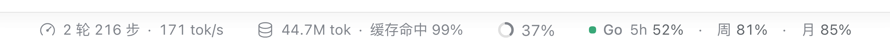
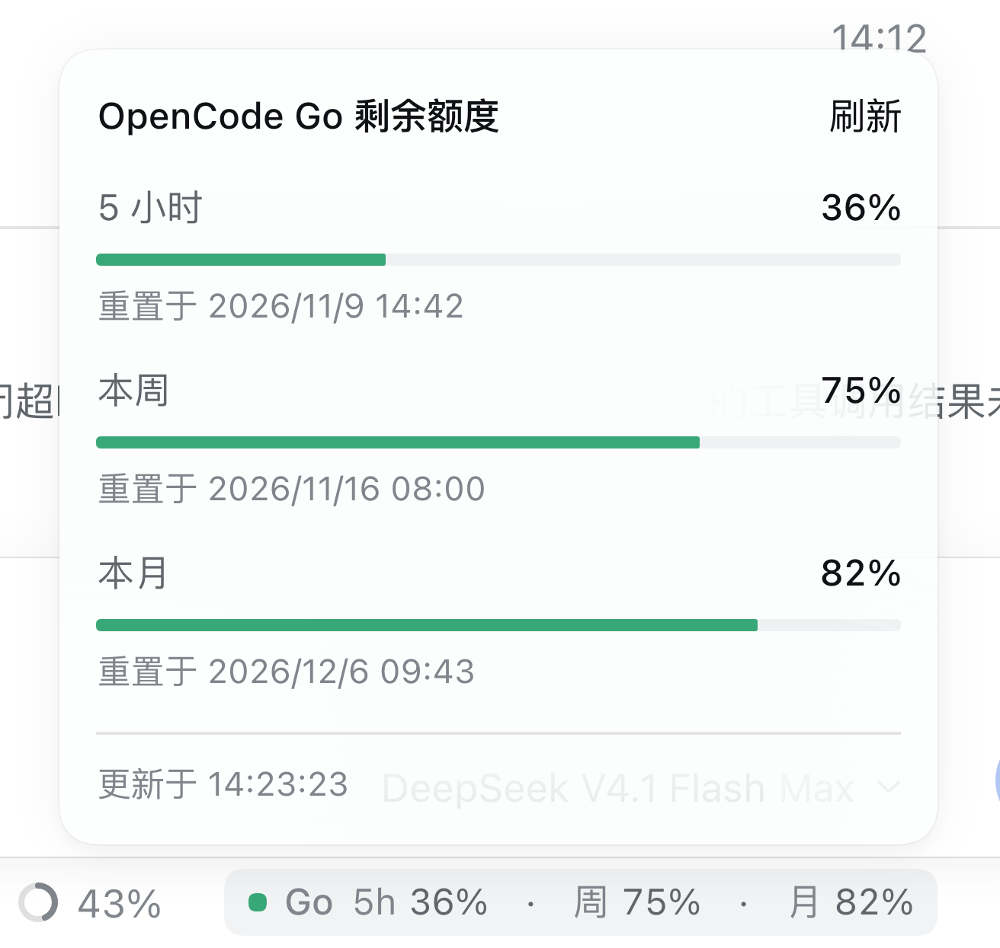
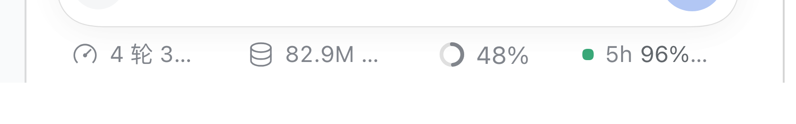

# dsh-opencode-go-quota

[English](README.md) · [中文](README.zh.md)

[](LICENSE)
[](package.json)
[](package.json)

A tiny [DeepSeek Harness](https://github.com/deepseek-ai/deepseek-harness) plugin that turns your
**OpenCode Go** subscription quota into one compact pill in the composer status row — right after the
context-window meter, next to the official session stats.



```text
⏱ 2 rounds 216 steps · 171 tok/s   🛢 44.7M tok · 99% cached   ◯ 37%   ● Go 5h 96% · 周 81% · 月 91%
└─────────────── official session stats ───────────────┘   ctx     └──── this plugin ────┘
```

Click the pill for a small anchored panel with a progress bar, remaining percentage and next reset
time for each window:



## Why

`opencode-go` is a first-class DSH provider, but the UI has no quota meter — you only find out that
the 5-hour window is exhausted when a request fails. This plugin reads the official
`GET {baseURL}/usage` endpoint with the key you already configured and keeps the numbers one glance
away, without adding a row, a card or a new panel to the layout.

## Features

- **Three official windows** — rolling 5-hour, weekly and monthly, shown as *remaining* percent
  (`100 − used`), with the dot turning amber/red as the 5-hour window runs low.
- **In the right place** — renders in the composer's `conversation.composer.dock` slot with a flex
  `order`, so it always sits after the context-window ring, at the right end of the stats row.
- **Details on click** — an anchored panel modeled on the official context-window panel: one block
  per window, progress bar, percentage, next reset, and a **Refresh** action. `Esc` or an outside
  click closes it; `aria-haspopup` / `aria-expanded` are set for screen readers.
- **Quiet by default** — no extra row, no permanent card. Refreshes every 60 s while the page is
  visible, pauses in background tabs, and the host caches a read for 15 s and coalesces concurrent
  calls.
- **Key never reaches the browser** — the host half resolves `OPENCODE_GO_API_KEY` from the DSH
  credential store and exposes only a validated, read-only quota snapshot through a DSH Remote
  method.
- **Resilient** — the last snapshot stays visible with an amber `!` when a refresh fails; missing
  key, bad key and network errors collapse into a short reason instead of an empty pill.
- **Truncates cleanly** — when the right sidebar squeezes the composer, the pill shrinks like the
  official stats pills: the `Go` brand hides first, then the text ellipsizes.



## Requirements

- DSH desktop or web app `>= 0.2.1-rc.5` (verified on 0.2.2-rc.1), Node 22.19+ / 24+.
- An OpenCode Go subscription API key already stored in DSH as `OPENCODE_GO_API_KEY` (the same key
  the native `opencode-go` provider uses), or exported under that name in the launch environment.

## Install

The plugin is plain JavaScript with no build step and no runtime dependencies beyond DSH itself.

**From the in-app Plugins page (easiest)**

1. Clone or download this repository.
2. Open **Settings → Plugins → Add plugin**, point it at the repository folder and enable
   `dsh-opencode-go-quota`.
3. Restart the desktop app (`⌘Q`, reopen) or reload the web page.

**From the command line**

```sh
git clone https://github.com/6520874/dsh-opencode-go-quota.git
dsh plugin --profile desktop add link:"$PWD/dsh-opencode-go-quota"
```

Use `--profile web` for the web app. Then quit and reopen the app so the host half is composed.

**Offline / air-gapped**

Copy the folder into `~/.dsh/profiles/desktop/node_modules/dsh-opencode-go-quota`, add
`dsh-opencode-go-quota` to `dsh.profile.bundles` in the profile's `package.json`, and restart. See
[INSTALL.md](INSTALL.md) for the manual `cordis.patch.yml` variant.

Either way the pill only appears in an **existing session** — the new-session hero page has no stats
row.

## Configuration

All fields are optional and live in the profile entry (`config:` in `cordis.patch.yml`):

| Field | Default | Meaning |
| --- | --- | --- |
| `baseURL` | `https://opencode.ai/inference/go/v1` | OpenCode Go gateway; the plugin reads `${baseURL}/usage`. |
| `apiKeyEnv` | `OPENCODE_GO_API_KEY` | Credential reference / environment variable holding the key. |
| `refreshMs` | `15000` | Host-side cache window; values below 3000 ms are clamped. |

```yaml
- id: opencode-go-quota
  name: dsh-opencode-go-quota
  config:
    refreshMs: 30000
```

## How it works

```text
browser (lib/client.js)                    host (lib/index.js)
  pill in composer.dock  ── Remote call ──▶  opencodeGoQuota.read
  polls every 60 s                         reads OPENCODE_GO_API_KEY
  renders snapshot                          GET {baseURL}/usage
                                            validates + normalizes the snapshot
```

- The host registers one direct Typert Remote method returning a strictly validated
  `{ fetchedAt, source, windows: { rolling, weekly, monthly } }`, where each window is
  `{ status, usedPercent, remainingPercent, resetsAt }`.
- The browser half mounts the Remote contribution and one `conversation.composer.dock` entry, polls
  politely, and localizes its strings through `ctx.locale` (zh/en).
- The detail panel is a `document.body` portal positioned with the shared
  `useAnchoredPosition` / `useDismissOnOutsidePointer` primitives, so it flips near screen edges and
  layers exactly like the official context-window panel.
- The API's `percent` is **used** percent; the pill shows `100 − percent` (one decimal kept host-side,
  rounded for display).

## Compatibility

| Surface | Status |
| --- | --- |
| DSH desktop (macOS / Windows / Linux) | ✅ verified |
| DSH web app | ✅ same bundle, `--profile web` |
| DSH `< 0.2.1-rc.5` | ❌ missing Remote/typert APIs |
| Node 22.19+ / 24+ | ✅ host + browser halves |

## Troubleshooting

| Symptom | Fix |
| --- | --- |
| No pill after install | Restart the desktop app fully (`⌘Q`); confirm the bundle is enabled under **Settings → Plugins**; make sure you are in an existing session, not the new-session page. |
| Pill says the quota is unavailable | Check that `OPENCODE_GO_API_KEY` exists in DSH credentials and that the machine can reach `https://opencode.ai`. |
| HTTP 401 / 403 | The key is missing, expired, or has no Go subscription. Re-add it in **Settings → Models**. |
| DSH fails to start after a manual install | Remove the appended `- insert:` block from the profile's `cordis.patch.yml` (or `dsh plugin --profile desktop remove dsh-opencode-go-quota`) and restart. |

## Privacy

No telemetry, no analytics, no session content is read. The only network traffic is the quota
request to the OpenCode Go base URL you configured, made from the DSH host process.

## Repository layout

```text
lib/index.js        host half: credentials, /usage fetch, Remote service
lib/client.js       browser half: pill, detail panel, polling (prebuilt module)
docs/               screenshots used by the READMEs
cordis.patch.yml    bundle layer: inserts the plugin into the profile
INSTALL.md          offline install instructions for sharing
```

## Development

There is no bundler: `lib/client.js` is a plain `window.__ModuleLoader__.load({...})` module and
`lib/index.js` is an ES module loaded by the host. Edit the files and restart (or reload the page)
to pick up changes; a running app also re-composes plugins when the profile directory changes.

## License

[MIT](LICENSE) © dsh-opencode-go-quota contributors

OpenCode Go and DeepSeek Harness are projects of their respective owners; this plugin is an
independent community add-on and is not affiliated with either.
