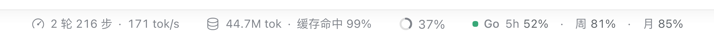
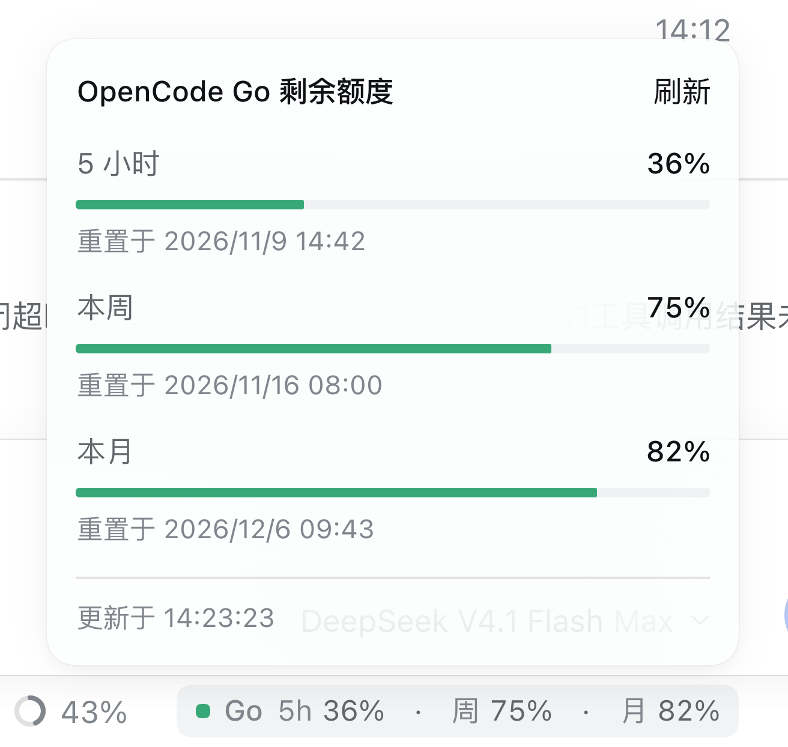
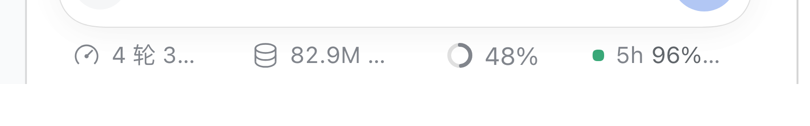

# dsh-opencode-go-quota

[English](README.md) · [中文](README.zh.md)

[](LICENSE)
[](package.json)
[](package.json)

一个很小的 [DeepSeek Harness](https://github.com/deepseek-ai/deepseek-harness) 插件：把 **OpenCode Go**
套餐的剩余额度做成一个紧凑胶囊，显示在会话输入框下方的 composer 状态行里 —— 紧挨官方 session 统计，
并且排在 **context window（上下文用量环）之后**。



```text
⏱ 2 轮 216 步 · 171 tok/s   🛢 44.7M tok · 缓存命中 99%   ◯ 37%   ● Go 5h 96% · 周 81% · 月 91%
└────────────── 官方 session 统计 ──────────────┘  上下文   └──── 本插件 ────┘
```

点击胶囊会打开一个紧贴它上方的小面板，样式与 context window 点击后的面板一致：每个窗口一条进度条、
剩余百分比和下一次重置时间。



## 为什么做这个

`opencode-go` 在 DSH 里是一等公民 provider，但界面上没有任何额度计量 —— 5 小时窗口用光了，你要等到
请求失败才知道。这个插件用你已经配置好的 Key 读取官方 `GET {baseURL}/usage`，把数字放在一眼就能看到
的地方，并且不新增一行、不加常驻卡片、不占布局空间。

## 功能

- **三个官方窗口** —— 5 小时滚动、本周、本月，显示**剩余**百分比（`100 − 已用`）；5 小时窗口余量偏低时
  圆点变琥珀 / 红。
- **位置正好** —— 注册进 composer 的 `conversation.composer.dock` 插槽，并用 flex `order` 保证永远排在
  context window 的圆环/百分比之后，也就是官方统计行最右侧。
- **点击看详情** —— 与官方 context window 面板同款：每个窗口一块（名称、剩余百分比、进度条、下次重置），
  右上角 **刷新** 立即拉取；`Esc` 或点击外部关闭。带 `aria-haspopup` / `aria-expanded`，读屏可用。
- **安静克制** —— 页面可见时每 60 秒刷新，切到后台自动暂停；宿主侧缓存 15 秒并合并并发读取。
- **Key 不出宿主** —— 宿主进程从 DSH 凭据库读取 `OPENCODE_GO_API_KEY`，浏览器侧只会收到校验过的、只读的
  额度快照。
- **容错** —— 单次刷新失败时保留上次数据并加琥珀色 `!`；未配置 Key / Key 无效 / 网络错误会显示成简短的
  原因，而不是消失。
- **窄布局优雅截断** —— 展开右侧边栏、中间内容被挤压时，胶囊像官方统计胶囊一样收缩：先隐藏 `Go` 品牌
  字样，再对文字做省略号截断。



## 依赖

- DSH 桌面版或 Web 版 `>= 0.2.1-rc.5`（已在 0.2.2-rc.1 验证），Node 22.19+ / 24+。
- 一个 OpenCode Go 订阅 API Key，已存放在 DSH 凭据库的 `OPENCODE_GO_API_KEY`（即原生 `opencode-go`
  provider 使用的那个 Key），或以同名环境变量提供。

## 安装

插件是纯 JavaScript，没有构建步骤，除 DSH 本身外没有运行时依赖。

**用 GUI 的插件页面（最省事）**

1. clone 或下载本仓库。
2. 打开 **设置 → 插件 → 添加插件**，指向仓库文件夹并启用 `dsh-opencode-go-quota`。
3. 重启桌面应用（`⌘Q` 后重开）或刷新 Web 页面。

**用命令行**

```sh
git clone https://github.com/6520874/dsh-opencode-go-quota.git
dsh plugin --profile desktop add link:"$PWD/dsh-opencode-go-quota"
```

Web 版把 `--profile desktop` 换成 `--profile web`。之后完全退出并重开 DSH，让宿主侧重新组合插件。

**离线 / 内网**

把文件夹复制到 `~/.dsh/profiles/desktop/node_modules/dsh-opencode-go-quota`，在 profile 的
`package.json` 的 `dsh.profile.bundles` 里加上 `dsh-opencode-go-quota`，然后重启。手动改
`cordis.patch.yml` 的方式见 [INSTALL.md](INSTALL.md)。

无论哪种方式，胶囊只出现在**已有会话**里 —— 新会话首屏没有统计行。

## 配置

所有字段都可选，写在 profile 条目的 `config:` 里（`cordis.patch.yml`）：

| 字段 | 默认值 | 含义 |
| --- | --- | --- |
| `baseURL` | `https://opencode.ai/inference/go/v1` | OpenCode Go 网关；插件读取 `${baseURL}/usage`。 |
| `apiKeyEnv` | `OPENCODE_GO_API_KEY` | 凭据引用 / 环境变量名。 |
| `refreshMs` | `15000` | 宿主侧缓存窗口；小于 3000 ms 会被钳制。 |

```yaml
- id: opencode-go-quota
  name: dsh-opencode-go-quota
  config:
    refreshMs: 30000
```

## 工作原理

```text
浏览器 (lib/client.js)                     宿主 (lib/index.js)
  composer.dock 里的胶囊  ── Remote 调用 ──▶  opencodeGoQuota.read
  每 60 秒轮询                             读取 OPENCODE_GO_API_KEY
  渲染快照                                 GET {baseURL}/usage
                                           校验并归一化快照
```

- 宿主注册一个 direct Typert Remote 方法，返回严格校验过的
  `{ fetchedAt, source, windows: { rolling, weekly, monthly } }`，每个窗口是
  `{ status, usedPercent, remainingPercent, resetsAt }`。
- 浏览器侧挂载 Remote contribution 和一个 `conversation.composer.dock` 条目，克制轮询，并通过
  `ctx.locale` 本地化文案（中/英）。
- 详情面板是 `document.body` 上的 portal，用共享的 `useAnchoredPosition` /
  `useDismissOnOutsidePointer` 原语定位，靠近屏幕边缘会自动翻转，层级与官方 context window 面板一致。
- 接口里的 `percent` 是**已用**百分比；胶囊显示 `100 − percent`（宿主保留一位小数，展示时取整）。

## 兼容性

| 环境 | 状态 |
| --- | --- |
| DSH 桌面版（macOS / Windows / Linux） | ✅ 已验证 |
| DSH Web 版 | ✅ 同一 bundle，用 `--profile web` |
| DSH `< 0.2.1-rc.5` | ❌ 缺少 Remote / typert API |
| Node 22.19+ / 24+ | ✅ 宿主端与浏览器端 |

## 排错

| 现象 | 处理 |
| --- | --- |
| 装完看不到胶囊 | 完全退出桌面应用再重开（`⌘Q`）；在 **设置 → 插件** 里确认 bundle 已启用；确认进入的是已有会话而不是新会话首页。 |
| 胶囊提示额度不可用 | 检查 DSH 凭据里是否有 `OPENCODE_GO_API_KEY`，以及机器能否访问 `https://opencode.ai`。 |
| HTTP 401 / 403 | Key 缺失、过期，或没有 Go 订阅。去 **设置 → 模型** 重新添加。 |
| 手动安装后 DSH 启动报错 | 删掉 profile `cordis.patch.yml` 里追加的 `- insert:` 块（或执行 `dsh plugin --profile desktop remove dsh-opencode-go-quota`），重启。 |

## 隐私

没有埋点、没有统计，不读取会话内容。唯一的网络请求是发往你配置的 OpenCode Go 地址的额度查询，由 DSH
宿主进程发出。

## 仓库结构

```text
lib/index.js       宿主侧：凭据、/usage 请求、Remote 服务
lib/client.js      浏览器侧：胶囊、详情面板、轮询（预构建模块）
docs/              README 引用的截图
cordis.patch.yml   bundle 层：把插件插入 profile
INSTALL.md         离线分发给同事的安装说明
```

## 开发

没有打包器：`lib/client.js` 是一个普通的 `window.__ModuleLoader__.load({...})` 模块，`lib/index.js` 是
宿主加载的 ES module。改完文件重启（或刷新页面）即可生效；运行中的应用在 profile 目录变化时也会重新组合
插件。

## 许可

[MIT](LICENSE) © dsh-opencode-go-quota contributors

OpenCode Go 与 DeepSeek Harness 分别属于其各自的所有者；本插件是独立的社区扩展，与二者没有隶属关系。
